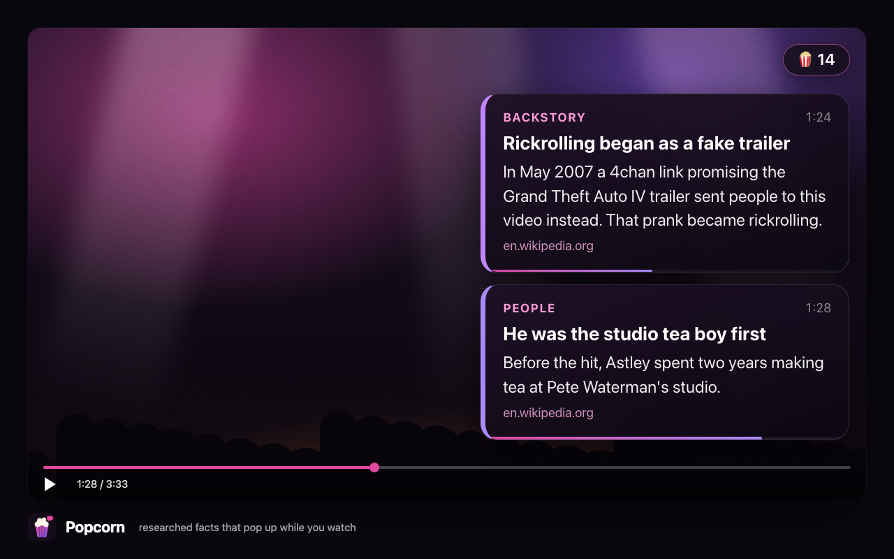
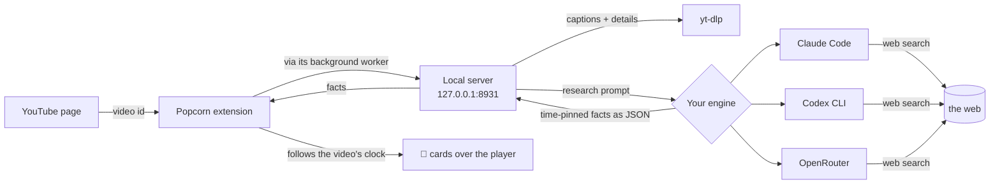

<p align="center">
  
</p>

<h1 align="center">Popcorn</h1>

<p align="center">
  <b>Researched facts that pop up over YouTube while you watch.</b><br>
  Runs on the AI you already pay for. Everything stays on your computer.
</p>

<p align="center">
  <a href="LICENSE"></a>
  
  
  
</p>

<p align="center">
  
</p>

---

Remember **Pop-Up Video**? Bubbles of trivia floating over music videos? Popcorn is that for anything
on YouTube, except the bubbles are researched.

Click **🍿** on a video. Popcorn reads the transcript, researches the video on the web, and pins each
fact to the second its subject comes up:

- **Backstory:** what was going on when this was made
- **People:** who that person actually is
- **Numbers:** the stat behind the claim
- **Updates:** what happened *after* the video came out
- **Corrections:** where the video is wrong or out of date

Every card links its source. Pause and the cards wait for you. Scrub and they follow. It works in
fullscreen, on Shorts, and it stays out of the way during ads.

## ⚡ Set it up in one message

Paste this to Claude Code, Codex, Cursor, or whatever AI agent you use:

```text
Set up Popcorn for me: https://github.com/joewilsonai/popcorn
Clone it and follow AGENT_SETUP.md in that repo. Ask me only what you can't figure out yourself.
```

Your agent checks your machine, finds the AI plan you already pay for, installs everything, and
walks you through the one click it can't make for you. Its instructions are in
[AGENT_SETUP.md](AGENT_SETUP.md).

## 💳 Runs on what you already have

| You have | Popcorn uses | Cost |
|---|---|---|
| **Claude Pro / Max** | [Claude Code](https://claude.com/claude-code) with web search | your plan's usage |
| **ChatGPT Plus / Pro** | [Codex CLI](https://github.com/openai/codex) with web search | your plan's usage |
| **Neither** | an [OpenRouter](https://openrouter.ai/keys) key: Claude, GPT, Gemini and more, with OpenRouter's web search | pay per use, about $0.20 for a 3-minute video on the default model |

There's no Popcorn account, server or subscription. Popcorn talks to YouTube and to the engine you
picked, and nothing else. If you have more than one engine, it moves to the next one when one runs
out. If you choose one, it never spends the others.

## 🛠 Install it yourself

You need macOS or Linux, Python 3.9+, Chrome (or Edge, Brave or Arc), and one engine from the table.

```bash
git clone https://github.com/joewilsonai/popcorn.git
cd popcorn
./install.sh
```

The installer gets `yt-dlp` if you don't have it, saves your settings, starts a small background
server, and runs a checkup. Using OpenRouter? Run `OPENROUTER_API_KEY=sk-or-... ./install.sh`, or
paste the key when the installer asks.

Then add the extension once:

1. Open `chrome://extensions` and turn on **Developer mode** (top right)
2. Click **Load unpacked** and choose the `extension` folder inside `popcorn`
3. Open any YouTube video. The **🍿** pill sits in the top-right of the player

### Make the cards yours

The cards have a voice, and you pick it:

```bash
./install.sh --name "Ziggy" --viewer "Sam" --voice "deadpan, nerdy, loves a footnote"
```

## 🎬 Using it

| Want to | Do this |
|---|---|
| Research the video you're on | Click **🍿 Pop facts for this**. The first cards land in about a minute and the rest fill in while you watch |
| Have it ready before you press play | `python3 popcorn.py add <youtube link>` |
| See every fact or jump to one | Click the 🍿 count |
| Redo a video | Click the 🍿 count, then **Research again** |
| Watch without the extension | Paste a link at `http://127.0.0.1:8931` |
| Watch on your phone or TV | `./install.sh --lan`, then open the private link that `python3 popcorn.py doctor` prints |
| Research everything you actually watch | `python3 popcorn.py config auto_research_after=30`: after 30 seconds of watching, it starts on its own. Videos you skip past cost nothing |

## ⚙️ How it works



- **One Python file** (`popcorn.py`) with no dependencies beyond the standard library: the research
  pipeline, the engines, and a tiny local server.
- **Fast first facts.** The opening four minutes and the rest of the video are researched at the
  same time, so you aren't staring at an empty screen.
- **No captions?** Popcorn can transcribe the audio with a Groq, OpenAI or ElevenLabs key
  (`python3 popcorn.py set-key groq`).
- **Sized to your screen.** Cards scale with the player, from a phone-size Short up to fullscreen on a
  big monitor.

## 🔒 Privacy and safety

- The server listens only on your own computer, unless you turn on LAN mode, and then only with a
  private key in the link. It refuses requests from other websites, including DNS-rebinding tricks,
  so a web page can't read your history or spend your plan.
- Video titles, descriptions and transcripts are treated as untrusted data, never as instructions. The
  research agent runs with web tools only and a stripped-down environment.
- Your settings, facts and keys live in `~/.popcorn`, and the keys file is readable only by you.
  Full policy: [PRIVACY.md](PRIVACY.md).

## ⚙️ Settings

`python3 popcorn.py config` shows everything, and `python3 popcorn.py config key=value` changes a
setting.

| Setting | Default | What it does |
|---|---|---|
| `engine` | `auto` | `claude`, `codex`, `openrouter`, or `auto` (try them in that order) |
| `claude_model` | `opus` | any `claude --model` value. `sonnet` is lighter on your plan |
| `codex_model` | Codex default | any `codex -m` value |
| `openrouter_model` | `anthropic/claude-sonnet-5.5` | any OpenRouter model with tool support. `google/gemini-3.5-flash` costs less |
| `host_name` / `viewer` / `voice` | Popcorn / - / sharp and warm | who's talking, who's watching, how it sounds |
| `fast_first` | `true` | researches the first four minutes first |
| `auto_research_after` | `0` (off) | seconds of actual watching before research starts by itself |
| `transcribe` | `auto` | for videos with no captions: `groq`, `openai`, `elevenlabs`, or `off` |
| `lan` | `false` | reachable from your phone or TV, behind a private key |
| `port` | `8931` | if you change it, also change it in `extension/bg.js` and `extension/manifest.json` |

## 🩺 When something's off

`python3 popcorn.py doctor` checks everything and tells you how to fix what's missing.
The server log is `~/.popcorn/server.log`, and each video's research log is in
`~/.popcorn/work/<video-id>/`. More fixes are in the troubleshooting table in
[AGENT_SETUP.md](AGENT_SETUP.md#troubleshooting).

- **Update:** `git pull`. The server restarts itself, and an unpacked extension reloads itself.
- **Remove:** `./install.sh --uninstall`, then remove the extension. Your facts stay in `~/.popcorn`.

## ❓ FAQ

**Is this a YouTube or Google product?** No. Popcorn is an independent open-source project and isn't
affiliated with YouTube or Google.

**Why does it need a local server instead of just an extension?** The research runs on *your*
engine: the Claude Code or Codex CLI on your machine, or your own key. A browser extension can't run
those by itself, so the small local server does.

**Does it work on Windows?** Not yet. macOS and Linux are supported. PRs are welcome.

**Can I contribute?** Yes, please. See [AGENTS.md](AGENTS.md) for how the code is laid out (it's
written for AI agents, and it works for people too).

## License

[MIT](LICENSE)
